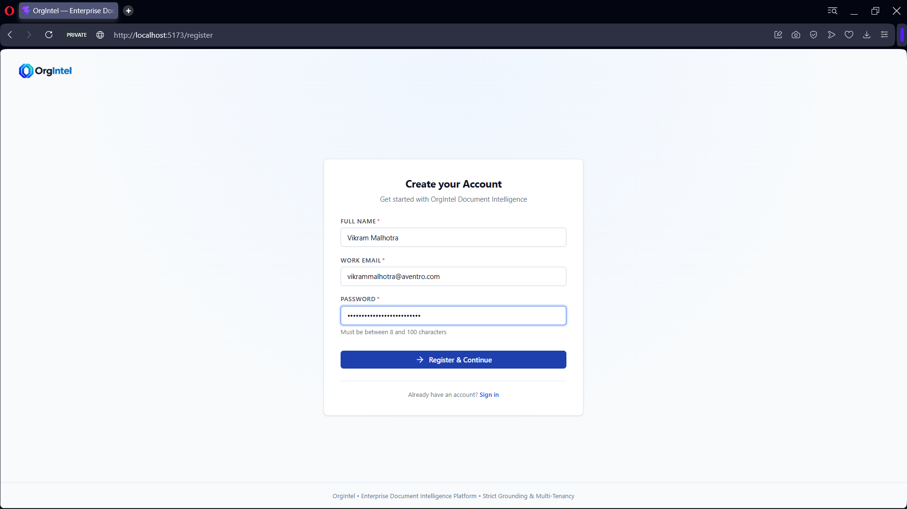
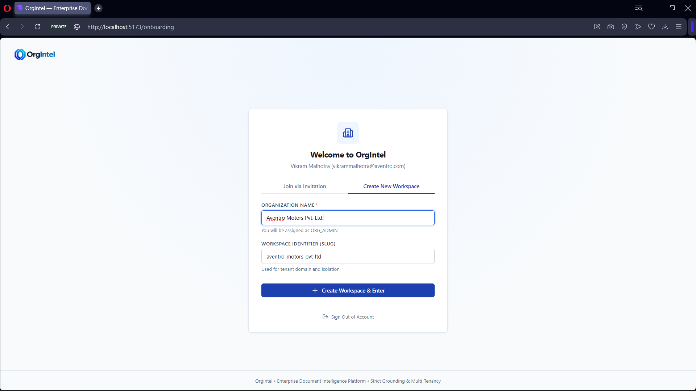
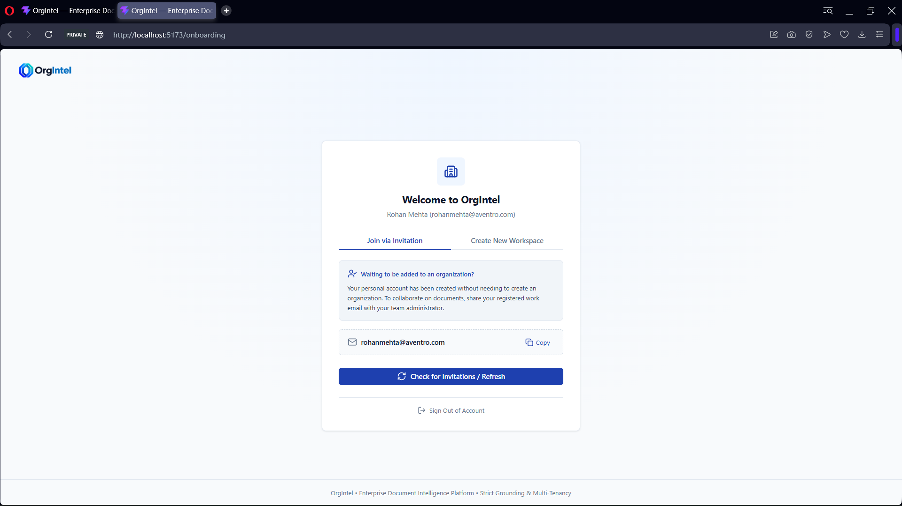
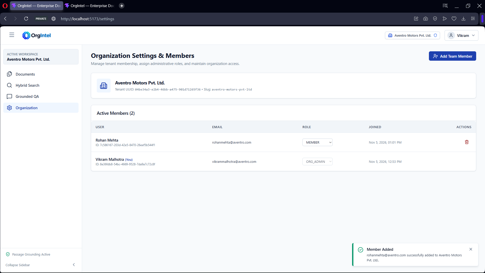
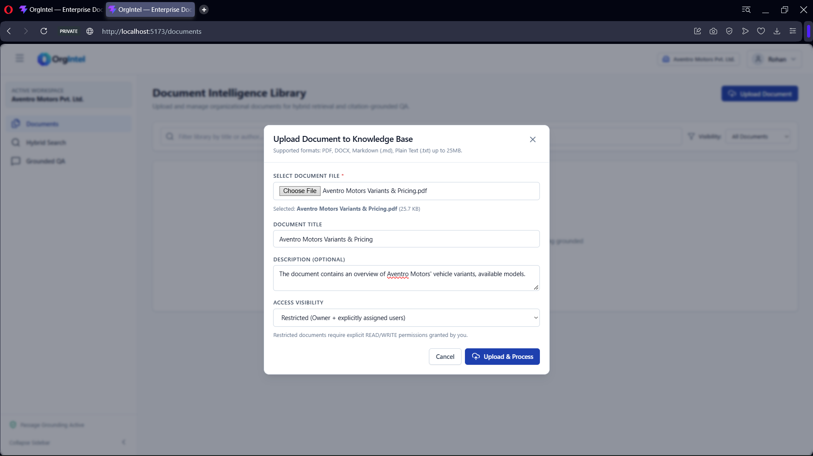
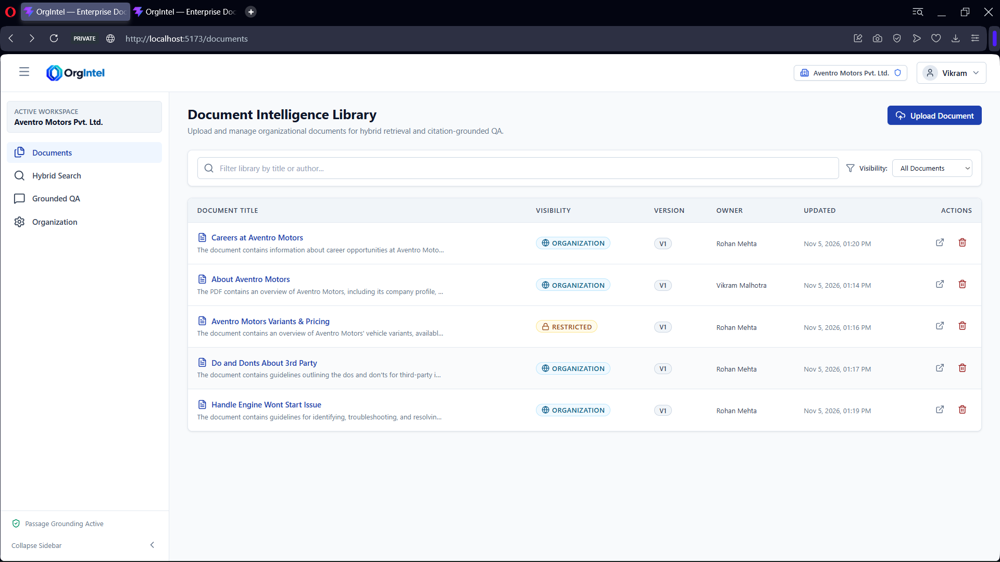
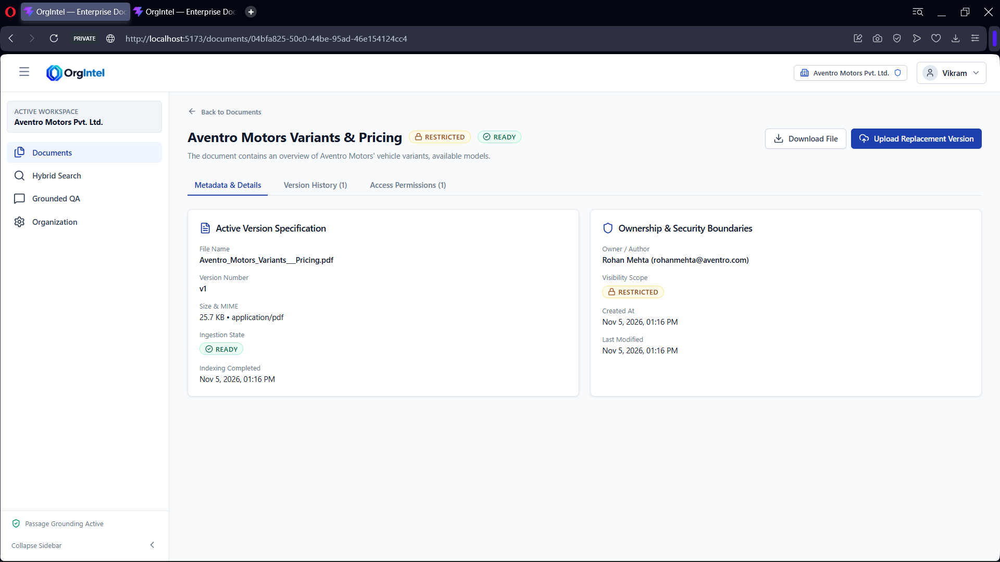
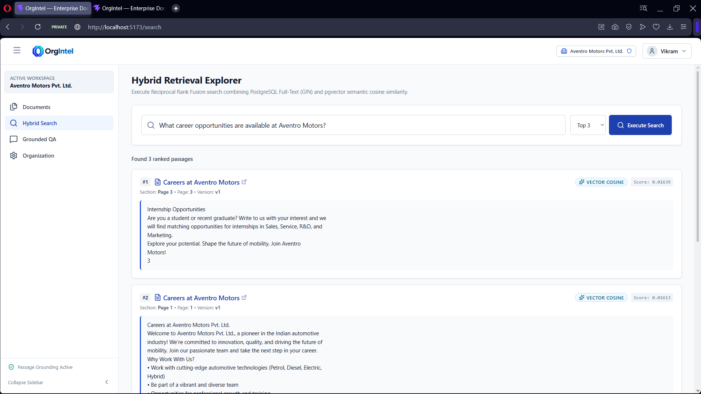
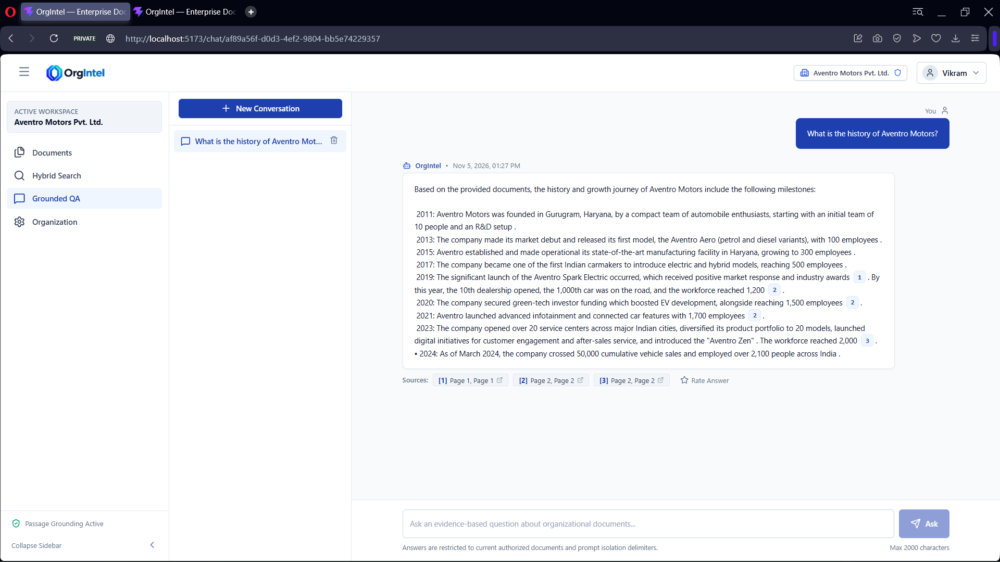

# 🏢 OrgIntel — Secure Multi-Tenant Enterprise Document Intelligence & Grounded QA Platform

A production-grade, enterprise-ready **Document Intelligence & Evidence-Grounded Question-Answering (RAG)** platform built with **Spring Boot** and **React (Vite)**.  
OrgIntel empowers organizations to securely ingest documents (PDF, DOCX, Markdown, Text), perform **hybrid search** combining **pgvector semantic similarity** and **PostgreSQL full-text search (GIN)** via **Reciprocal Rank Fusion (RRF)**, and query their knowledge base with **verifiable citation grounding** powered by **Google Gemini**.

---

## 🧱 Tech Stack

### 🖥️ Frontend

- **React 19** — Modern functional components & hooks
- **Vite** — Fast build tool and dev server
- **React Router v7** — Declarative client-side routing & route guards
- **Zustand** — Lightweight state management (auth, active tenant, notifications, UI)
- **Axios** — HTTP client with automated JWT refresh and `X-Organization-Id` tenant propagation
- **Lucide React** — enterprise iconography

### ⚙️ Backend

- **Java 21**
- **Spring Boot**
- **Spring AI** — Native Google GenAI integration
- **PostgreSQL & pgvector** — Relational storage with vector embeddings
- **Spring Data JPA & Hibernate** — Schema management and persistence layer
- **Spring Security & Stateless JJWT** — HMAC-SHA256 tokens with refresh token rotation & revocation
- **Document Extractors** — Apache PDFBox, CommonMark, DOCX & Plain Text parsers
- **SpringDoc OpenAPI** — Interactive Swagger UI documentation
- **Spring Boot Actuator** — Health, info, and metrics monitoring
- **Docker & Docker Compose** — Automated PostgreSQL + pgvector container orchestration

---

## ✨ Key Features

- 🏢 **Strict Multi-Tenant Isolation:** Complete logical tenant separation via `TenantFilter`, `X-Organization-Id` header enforcement, organization slugs, and Role-Based Access Control (`ORG_ADMIN`, `MEMBER`).
- 📄 **Multi-Format Document Ingestion:** Asynchronous pipeline (`IngestionWorker`) supporting PDF, DOCX, Markdown, and Plain Text files up to 25MB with configurable chunking (1500 chars, 300 char overlap).
- 🔍 **Hybrid Retrieval Engine (RRF):** Merges PostgreSQL Full-Text Search (GIN `to_tsvector`) with pgvector semantic cosine similarity using Reciprocal Rank Fusion ($k=60$) for optimal recall and precision.
- 🎯 **Grounded Answering & Hallucination Defense:** Prompt isolation with strict XML boundaries (`<context>`), mandatory passage citation verification (`[chunk:<id>]`), and deterministic abstention when evidence is insufficient.
- ⚡ **Real-Time Streaming:** Server-Sent Events (SSE) streaming (`MediaType.TEXT_EVENT_STREAM_VALUE`) for low-latency conversational AI output alongside standard REST JSON responses.
- 🔐 **Document-Level Access Controls:** Granular visibility policies (`ORGANIZATION` vs `RESTRICTED`) and explicit user-level read/write permissions.
- 📊 **Feedback & Auditability:** Answer rating, user feedback submission, version history tracking, and active background job status polling.

---

## 📸 Screenshots

### 1. User Registration & Account Creation
Clean registration screen supporting enterprise user onboarding with password policy validation and secure credential hashing.


---

### 2. Workspace & Organization Setup (Multi-Tenancy)
New organization creation flow with automated slug generation, tenant domain isolation, and initial `ORG_ADMIN` assignment.


---

### 3. Join Workspace via Invitation
Invitation-based onboarding allowing team members to wait for organizational access and verify membership status.


---

### 4. Organization Settings & Member Management
Tenant management interface providing member listings, dynamic role promotion/demotion (`ORG_ADMIN` / `MEMBER`), and team member invitations.


---

### 5. Document Ingestion & Access Controls
Document upload modal supporting PDF, DOCX, Markdown, and Plain Text up to 25MB with configurable visibility scopes (`ORGANIZATION` or `RESTRICTED`).


---

### 6. Document Intelligence Library
Centralized organizational knowledge base displaying document metadata, visibility badges, version numbers, owner attribution, and search filters.


---

### 7. Document Details, Version Specification & Permissions
Detailed document view featuring active version specifications, ingestion states (`READY`, `INDEXED`), file downloads, replacement version uploads, and explicit user-level permissions.


---

### 8. Hybrid Retrieval Explorer (Reciprocal Rank Fusion)
Interactive search explorer visualizing ranked passage results from combined PostgreSQL Full-Text (GIN) and pgvector semantic cosine similarity with RRF scores.


---

### 9. Evidence-Grounded QA with Passage Citations
Grounded question-answering interface featuring inline verifiable citation badges (`[1]`, `[2]`, `[3]`), passage source drawers with page numbers, and answer feedback ratings.


---

## 📁 Project Structure

```text
OrgIntel/
│
├── orgintel-backend/                  # Spring Boot Backend Application
│   ├── src/
│   │   ├── main/
│   │   │   ├── java/io/rahulnanhore/
│   │   │   │   ├── OrgIntelBackendApplication.java
│   │   │   │   └── orgintel/
│   │   │   │       ├── ai/             # Grounded answering, citation validation & prompts
│   │   │   │       ├── common/         # DTOs, global exceptions, tenant context
│   │   │   │       ├── conversation/   # Conversations, messages, SSE streaming & feedback
│   │   │   │       ├── document/       # Document metadata, versions & permission checks
│   │   │   │       ├── identity/       # User entity, JWT authentication & security filters
│   │   │   │       ├── ingestion/      # Multi-format extractors (PDF, DOCX, MD), chunking & worker
│   │   │   │       ├── organization/   # Multi-tenancy, organizations, memberships & tenant filter
│   │   │   │       ├── retrieval/      # Hybrid search (pgvector + GIN) & RRF fusion service
│   │   │   │       └── storage/        # Storage abstraction & local file persistence
│   │   │   └── resources/
│   │   │       ├── application.yaml
│   │   │       └── application-local.yaml
│   ├── docker-compose.yml             # PostgreSQL 16 + pgvector container service
│   ├── Dockerfile                     # Multi-stage container build
│   ├── mvnw / mvnw.cmd                # Maven wrapper
│   └── pom.xml
│
├── orgintel-frontend/                 # React 19 + Vite Frontend Application
│   ├── src/
│   │   ├── app/                       # App root, React Router v7 configuration & route constants
│   │   ├── assets/                    # Static branding & assets
│   │   ├── components/                # UI primitives, chat citations, modals & navigation
│   │   ├── hooks/                     # Custom React hooks (useAuth, useOrganization, usePolling)
│   │   ├── layouts/                   # AuthLayout, AppLayout, WorkspaceLayout
│   │   ├── pages/                     # Auth, Onboarding, Documents, Search, Chat, Settings
│   │   ├── services/                  # Axios HTTP client, JWT interceptor, API services
│   │   ├── stores/                    # Zustand stores (authStore, orgStore, uiStore, notificationStore)
│   │   ├── styles/                    # Design tokens & CSS stylesheets
│   │   └── main.jsx
│   ├── public/
│   ├── package.json
│   └── vite.config.js
│
└── README.md
```

---

## ⚙️ Backend Setup (Spring Boot)

### 🧩 Prerequisites

- **Java 21+** (JDK 21)
- **Maven 3.9+** (or use the included `./mvnw` / `mvnw.cmd`)
- **Docker & Docker Compose** (for PostgreSQL + pgvector)
- **Google Gemini API Key** (obtainable from [Google AI Studio](https://aistudio.google.com/))
- **Git**

---

### 🧰 Steps to Run Backend

1. **Navigate to the backend folder:**

   ```bash
   cd orgintel-backend
   ```

2. **Start PostgreSQL with pgvector using Docker Compose:**

   ```bash
   docker compose up postgres -d
   ```

   > This launches PostgreSQL 16 with the `pgvector` extension enabled on port `5434` (mapped from container `5432`).

3. **Configure Environment Variables:**

   You can export variables or set them in your environment:

   ```bash
   # On macOS/Linux
   export GEMINI_API_KEY="your-google-gemini-api-key"
   export SPRING_DATASOURCE_URL="jdbc:postgresql://localhost:5434/veridoc?stringtype=unspecified"
   export SPRING_DATASOURCE_USERNAME="postgres"
   export SPRING_DATASOURCE_PASSWORD="postgres"

   # On Windows (PowerShell)
   $env:GEMINI_API_KEY="your-google-gemini-api-key"
   $env:SPRING_DATASOURCE_URL="jdbc:postgresql://localhost:5434/veridoc?stringtype=unspecified"
   $env:SPRING_DATASOURCE_USERNAME="postgres"
   $env:SPRING_DATASOURCE_PASSWORD="postgres"
   ```

4. **Run the Spring Boot application:**

   ```bash
   # On macOS/Linux
   ./mvnw spring-boot:run

   # On Windows
   mvnw.cmd spring-boot:run
   ```

📍 **Backend runs on:** `http://localhost:8080`  
📑 **Swagger UI Documentation:** `http://localhost:8080/swagger-ui.html`  
🩺 **Actuator Health Check:** `http://localhost:8080/actuator/health`

---

## 💻 Frontend Setup (React + Vite)

### 🧩 Prerequisites

- **Node.js 18+** (Node.js 20+ recommended)
- **npm** (or yarn / pnpm)

---

### ⚙️ Steps to Run Frontend

1. **Navigate to the frontend folder:**

   ```bash
   cd orgintel-frontend
   ```

2. **Install dependencies:**

   ```bash
   npm install
   ```

3. **Create environment file (optional, defaults are pre-configured):**

   ```bash
   # Create .env from example
   cp .env.example .env
   ```

   ```env
   VITE_API_BASE_URL=/api/v1
   VITE_APP_TITLE=OrgIntel — Enterprise Document Intelligence
   ```

4. **Start the Vite development server:**

   ```bash
   npm run dev
   ```

📍 **Frontend runs on:** `http://localhost:5173`  
*The Vite dev server automatically proxies `/api` and `/actuator` requests to the Spring Boot backend at `http://localhost:8080`.*

---

### 1. Multi-Tenant Context Propagation
- Every authenticated request carries a stateless JWT Bearer token and an `X-Organization-Id` tenant UUID header.
- `TenantFilter` validates that the user possesses active membership in the target organization before reaching domain controllers.

### 2. Document Ingestion Pipeline
- When a document is uploaded via `POST /api/v1/organizations/{id}/documents`, it is stored on disk and an `IngestionJob` is queued.
- `IngestionWorker` extracts text using Apache PDFBox (PDF), CommonMark (Markdown), or plain text readers, then partitions text into overlapping chunks (1500 characters, 300 characters overlap).
- Embeddings (768 dimensions) are generated via `gemini-embedding-2` and persisted into PostgreSQL with `pgvector` indexing alongside GIN full-text indexes.

### 3. Hybrid Retrieval & Reciprocal Rank Fusion (RRF)
- The search query executes two parallel candidate retrieval strategies:
  - **Full-Text Keyword Search:** Utilizes PostgreSQL full-text search (`ts_rank`, GIN index).
  - **Semantic Vector Search:** Computes cosine distance against 768-dimensional embeddings in `pgvector`.
- The `RrfFusionService` merges both ranked candidate sets using the reciprocal rank fusion formula:
  $$\text{RRF Score}(d) = \sum_{m \in M} \frac{1}{k + r_m(d)} \quad (k = 60)$$
- Passages are ordered by combined relevance and filtered by organization and document access permissions.

### 4. Grounded Answering with Citation Validation
- Candidate passages are formatted inside strict `<context>` boundaries with explicit prompt injection defense rules.
- Google Gemini generates the answer citing specific passage chunks (`[chunk:<chunk_id>]`).
- `CitationValidator` validates citation integrity against retrieved chunks. If evidence is insufficient, the system abstains deterministically:
  > *"Based on the provided documents, there is insufficient evidence to answer this question."*

---

## 🔌 Key API Endpoints

| Module | Method | Endpoint | Description |
|---|---|---|---|
| **Auth** | `POST` | `/api/v1/auth/register` | Register a new user account |
| **Auth** | `POST` | `/api/v1/auth/login` | Login and receive JWT access & refresh tokens |
| **Auth** | `POST` | `/api/v1/auth/refresh` | Rotate expired access token using refresh token |
| **Auth** | `POST` | `/api/v1/auth/logout` | Revoke active refresh token |
| **Organization** | `POST` | `/api/v1/organizations` | Create a new tenant workspace |
| **Organization** | `GET` | `/api/v1/organizations` | List organizations for current user |
| **Organization** | `GET` | `/api/v1/organizations/{id}/members` | List members in organization |
| **Organization** | `POST` | `/api/v1/organizations/{id}/members` | Add new member by email |
| **Organization** | `PATCH` | `/api/v1/organizations/{id}/members/{uid}/role` | Update member role (`ORG_ADMIN`, `MEMBER`) |
| **Documents** | `POST` | `/api/v1/organizations/{id}/documents` | Multipart document upload (PDF, DOCX, MD, TXT) |
| **Documents** | `GET` | `/api/v1/organizations/{id}/documents` | List documents with visibility filters |
| **Documents** | `GET` | `/api/v1/organizations/{id}/documents/{docId}` | Get document details and active version |
| **Documents** | `POST` | `/api/v1/organizations/{id}/documents/{docId}/versions` | Upload replacement version |
| **Documents** | `GET` | `/api/v1/organizations/{id}/documents/{docId}/download` | Download original document file |
| **Documents** | `POST` | `/api/v1/organizations/{id}/documents/{docId}/permissions` | Assign document-level user permission |
| **Search** | `POST` | `/api/v1/organizations/{id}/search` | Execute hybrid search (RRF: GIN + pgvector) |
| **Conversation** | `POST` | `/api/v1/organizations/{id}/conversations` | Create a new Q&A conversation thread |
| **Conversation** | `GET` | `/api/v1/organizations/{id}/conversations` | List conversation threads |
| **Conversation** | `POST` | `/api/v1/organizations/{id}/conversations/{cId}/messages` | Ask question with citation grounding (JSON or SSE stream) |
| **Conversation** | `POST` | `/api/v1/organizations/{id}/conversations/{cId}/messages/{mId}/feedback` | Submit answer feedback & rating |
| **Jobs** | `GET` | `/api/v1/organizations/{id}/jobs/{jobId}` | Poll ingestion job status (`QUEUED`, `RUNNING`, `COMPLETED`, `FAILED`) |
| **Jobs** | `POST` | `/api/v1/organizations/{id}/jobs/{jobId}/retry` | Retry a failed ingestion job |

---

## 🧰 Common Commands

| Task | Command | Directory |
|---|---|---|
| **Start Database (Docker)** | `docker compose up postgres -d` | `orgintel-backend` |
| **Stop Database (Docker)** | `docker compose down` | `orgintel-backend` |
| **Run Backend** | `./mvnw spring-boot:run` *(Windows: `mvnw.cmd spring-boot:run`)* | `orgintel-backend` |
| **Package Backend (JAR)** | `./mvnw clean package` | `orgintel-backend` |
| **Run Backend Tests** | `./mvnw test` | `orgintel-backend` |
| **Install Frontend Deps** | `npm install` | `orgintel-frontend` |
| **Run Frontend Dev** | `npm run dev` | `orgintel-frontend` |
| **Build Frontend** | `npm run build` | `orgintel-frontend` |
| **Lint Frontend** | `npm run lint` | `orgintel-frontend` |
| **Run Frontend Tests** | `npm test` | `orgintel-frontend` |

---

## 🧑‍💻 Author

**Rahul Nanhore**  
*Full Stack Developer*  
🌐 [linkedin.com/in/rahulnanhore](https://www.linkedin.com/in/rahulnanhore)  
🐙 [github.com/rahulnanhore05](https://github.com/rahulnanhore05)  

---

⭐ **If this project helped you, consider giving it a star!**

